# Astra Productions Game Engine

[](https://github.com/cyberwall001/Astra-Productions-Game-Engine/releases/latest)
[](https://github.com/cyberwall001/Astra-Productions-Game-Engine/actions/workflows/windows.yml)

**Download:** every merge to `main` publishes a fresh `v0.x` build — grab
`astra-studio-<version>-windows-x64.zip` from
[Releases](https://github.com/cyberwall001/Astra-Productions-Game-Engine/releases/latest).

A general-purpose game engine and studio, written from scratch in C++17 for Windows.
No Unity, no Unreal, no wrapper: the window layer, renderer, scene graph, crypto, account
registry, offline access-code licensing, GitHub project hub and the whole UI toolkit live in
this repository.

**Milestone 2 — the level viewport.** The editor now ships a working 3D viewport: orbit /
pan / zoom navigation, lit and wireframe view modes, a fading world grid, ground shadows,
screen-space picking and live draw statistics. Actors carry real static meshes (cube, sphere,
cylinder, cone, plane) instead of being abstract nodes, and the panel set follows the Unreal
vocabulary: **World Outliner · Level Viewport · Details · Content Browser · Output Log**.

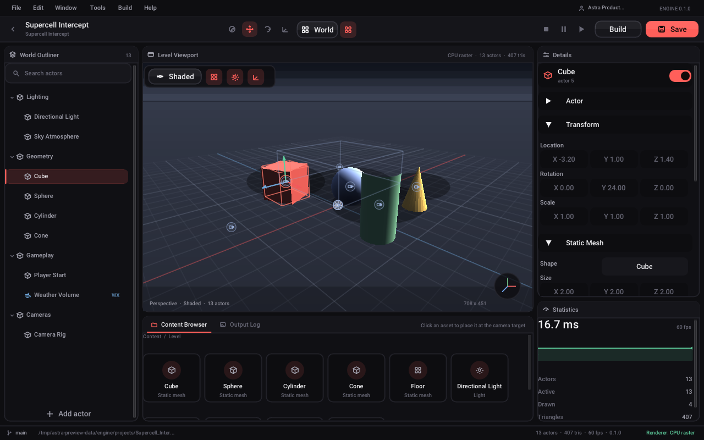

| Shaded | Wireframe |
| --- | --- |
|  | 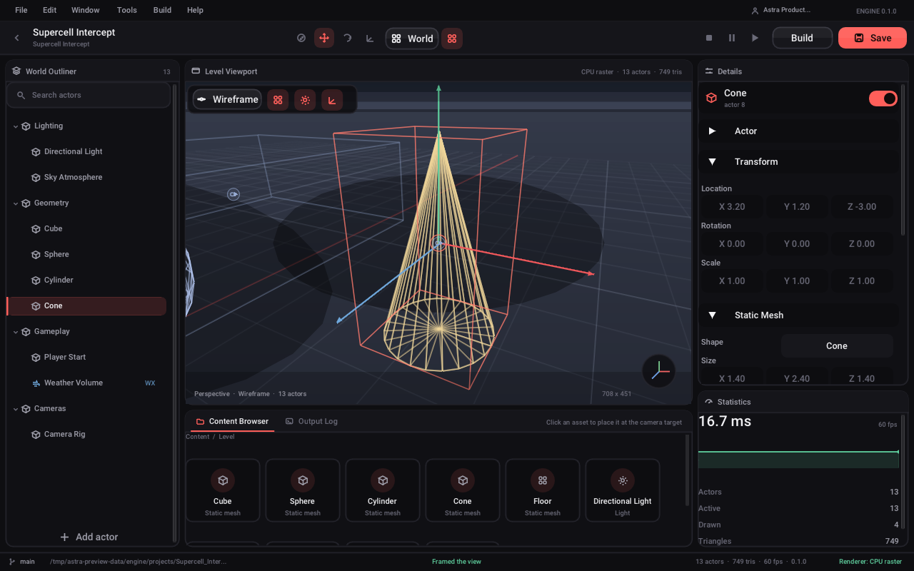 |

Weather is now one optional system among many: the default level is a neutral sandbox, and
storm volumes are a template you can drop in from the Content Browser.

## What is in the box

| | |
| --- | --- |
| **Astra Studio** (`AstraStudio.exe`) | loading screen → boot sequence → sign-in → registration → project hub → editor |
| **Astra KeyForge** (`AstraKeyForge.exe`) | owner-only tool that mints single-use engine access codes |
| **Headless tools** | `astra_selfcheck` (216 assertions) and `astra_uipreview` (renders every screen to PNG) |

### Launcher flow

| Loading | Boot sequence | Sign in |
| --- | --- | --- |
| 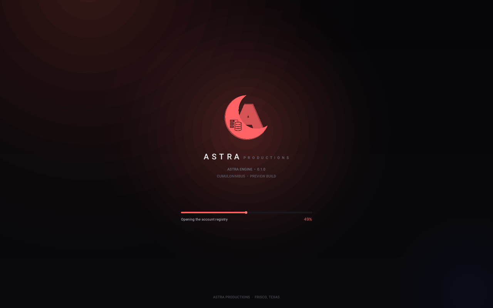 | 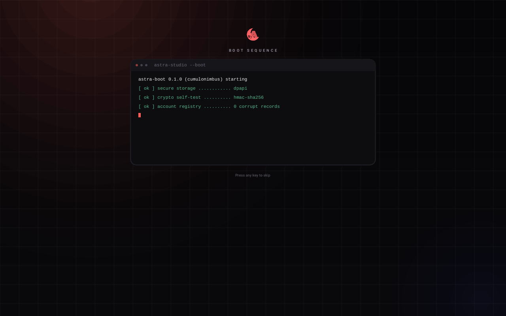 | 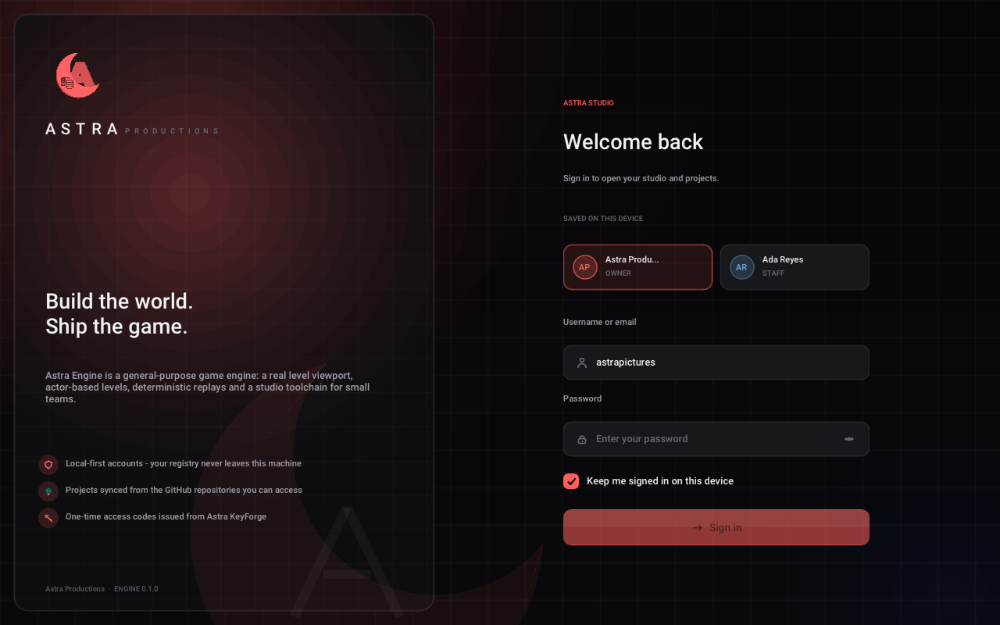 |

| Access code | Registration | Project hub |
| --- | --- | --- |
| 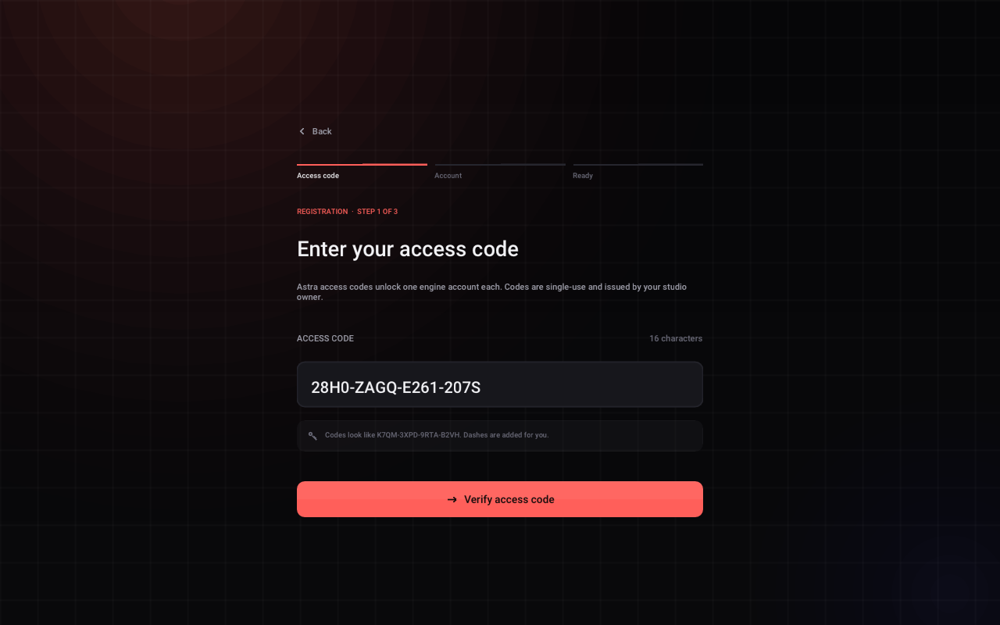 | 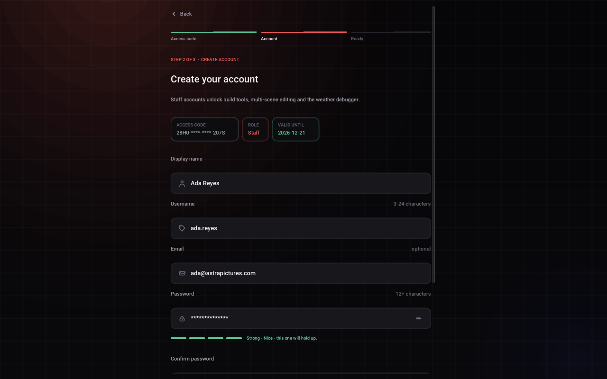 | 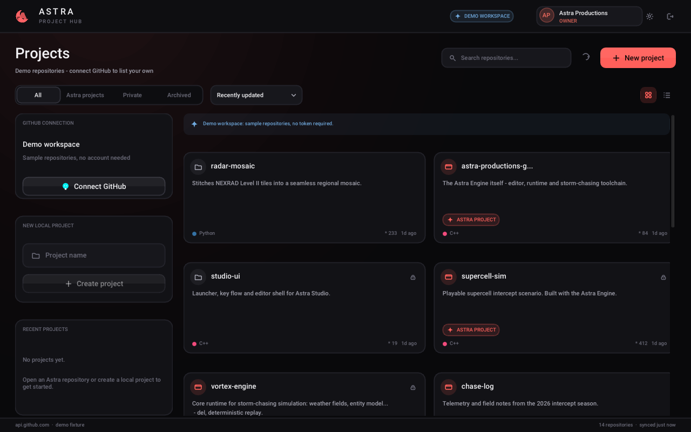 |

### Studio

| Level viewport | Settings | Command palette |
| --- | --- | --- |
|  | 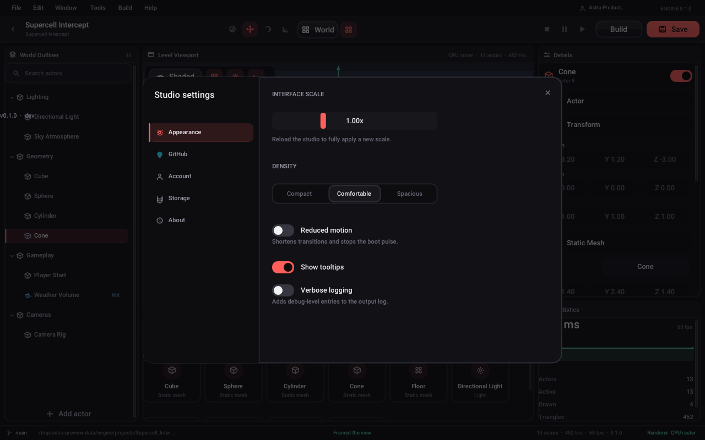 | 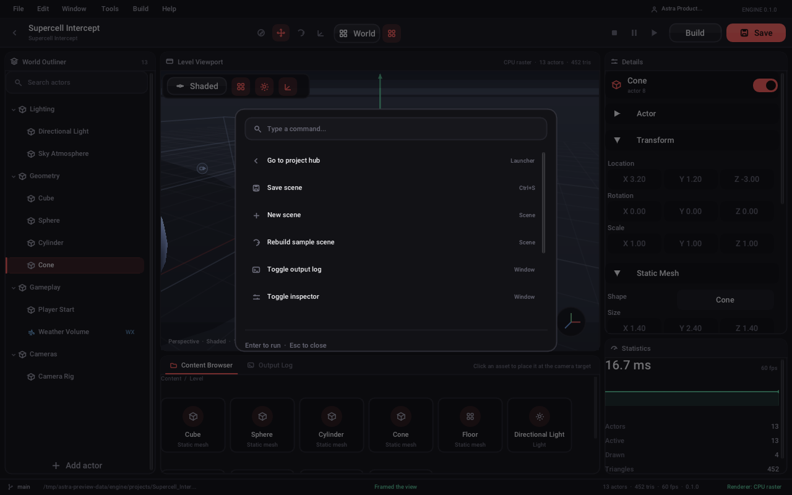 |

### Owner tool

| Passphrase gate | Issue codes | Ledger |
| --- | --- | --- |
| 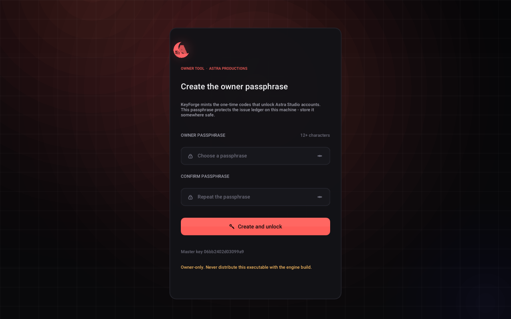 | 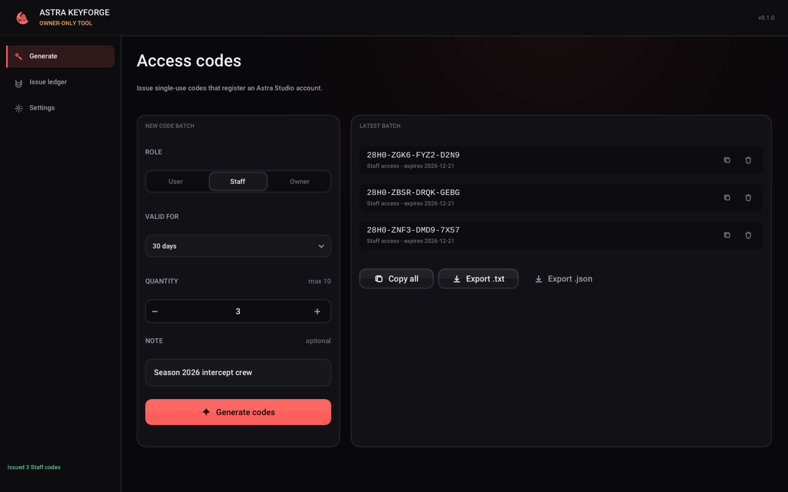 | 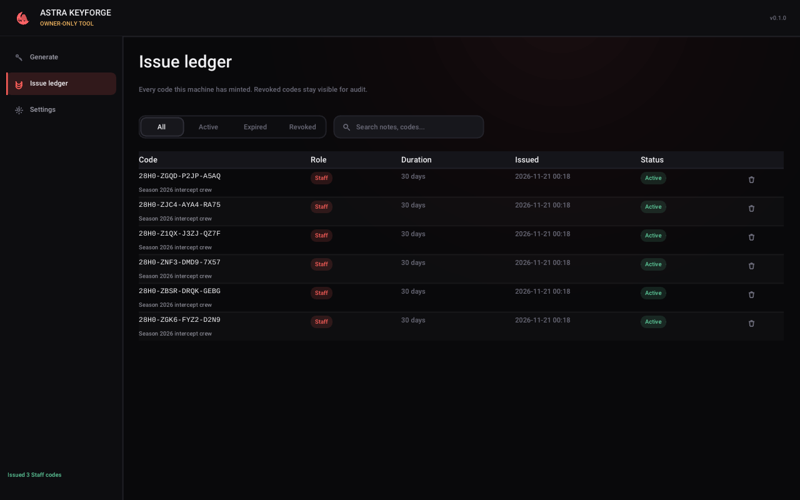 |

*(Every screenshot above is rendered from the real UI code by `astra_uipreview`, not mocked up.)*

## Viewport controls

| Input | Action |
| --- | --- |
| Right drag (or Alt + left drag) | Orbit the level camera |
| Middle drag | Pan |
| Wheel | Zoom (dolly towards the camera target) |
| Left click | Select the actor under the cursor (in the World Outliner too) |
| `F` | Frame the selected actor (or the whole level) |
| `Q` `W` `E` `R` | Select / Move / Rotate / Scale tool |
| `Delete` | Delete the selected actor |
| `Ctrl+S` | Save the level |

The viewport header carries the view-mode picker (Shaded, Unlit, Wireframe, Normals) plus
toggles for grid, shadows and gizmos, and reports the CPU raster budget per frame. The bottom
drawer switches between the **Content Browser** (click an asset to place it) and the
**Output Log**.

## Access codes

Registration is gated by codes that only the studio owner can mint:

* 16 Crockford characters (`K7QM-3XPD-9RTA-B2VH`), signed with HMAC-SHA256 and fully
  verifiable offline.
* Each code carries its role (`User` / `Staff` / `Owner`) and lifetime (24 h … never) and is
  **single-use per install**.
* KeyForge requires an owner passphrase (PBKDF2, 200 000 iterations) on every launch, keeps
  an issue ledger, and exports batches to `.txt` / `.json`.

Details and the migration to Ed25519 public-key codes in 0.2: [docs/SECURITY.md](docs/SECURITY.md).

## Build

Windows 10/11 x64, Visual Studio 2022, CMake 3.20+:

```powershell
cmake --preset windows-msvc
cmake --build --preset windows-msvc-release
ctest --preset windows-msvc
pwsh tools/package_windows.ps1 -Configuration Release   # -> dist/astra-studio-<ver>-windows-x64.zip
```

Any OS with a C++17 compiler can build and run the headless tools:

```bash
cmake --preset headless && cmake --build --preset headless
./build/headless/astra_selfcheck
./build/headless/astra_uipreview --smoke
```

CI builds the Windows zip and uploads it as the `astra-studio-windows-x64` artifact on every
push. Step-by-step instructions and troubleshooting: [docs/BUILD_WINDOWS.md](docs/BUILD_WINDOWS.md).

## Repository layout

```
src/astra/core        types, strings, paths, file IO, time, logging
src/astra/crypto      SHA-256, HMAC, PBKDF2, base32, RNG, DPAPI wrapper
src/astra/data        JSON reader/writer
src/astra/licensing   access codes, master key, issue ledger
src/astra/auth        accounts, sessions, registration
src/astra/github      transport iface, WinHTTP, parsing, demo fixture
src/astra/render      orbit camera, mesh generation, CPU viewport rasteriser, picking
src/astra/scene       entities, components (transform/mesh/light/camera/weather), reflection
src/astra/project     astra.project.json, scene IO, recent projects
src/astra/ui          theme, icons, widget library, branding
src/astra/app         AstraApp flow, screens, editor panels, KeyForge
src/platform          GLFW + OpenGL3 window frontend
src/studio            AstraStudio.exe entry point
src/keygen            AstraKeyForge.exe entry point (GUI + --issue-code CLI)
src/tools             self-check suite and headless UI renderer
assets/               logo, fonts, demo workspace fixture
extern/               Dear ImGui 1.91.9b-docking, stb_image
docs/                 architecture, security, UI guide, build + release guides, roadmap, screenshots
tools/                packaging, screenshot capture, PNG recompression
```

## Documentation

* [docs/ARCHITECTURE.md](docs/ARCHITECTURE.md) — layers, threading, on-disk layout, verification strategy
* [docs/SECURITY.md](docs/SECURITY.md) — access codes, accounts, secrets at rest, network surface
* [docs/UI_GUIDE.md](docs/UI_GUIDE.md) — design tokens, components, layout rules, motion
* [docs/BUILD_WINDOWS.md](docs/BUILD_WINDOWS.md) — prerequisites, presets, packaging, troubleshooting
* [docs/ROADMAP.md](docs/ROADMAP.md) — viewport milestones, gameplay, team workflow
* [docs/RELEASING.md](docs/RELEASING.md) — how every merge to `main` becomes a `v0.x` release

## Dependencies

Dear ImGui (MIT) and stb_image (public domain) are vendored under `extern/`. GLFW 3.4 (zlib
licence) is fetched by CMake on first configure. Everything else — crypto, JSON, HTTP, UI,
licensing — is implemented here. Fonts are Roboto (Apache-2.0) and Cousine (Apache-2.0); see
`assets/fonts/LICENSE.txt`.

## Licence

MIT — see [LICENSE](LICENSE). © 2026 Cyberwall / Astra Productions.
